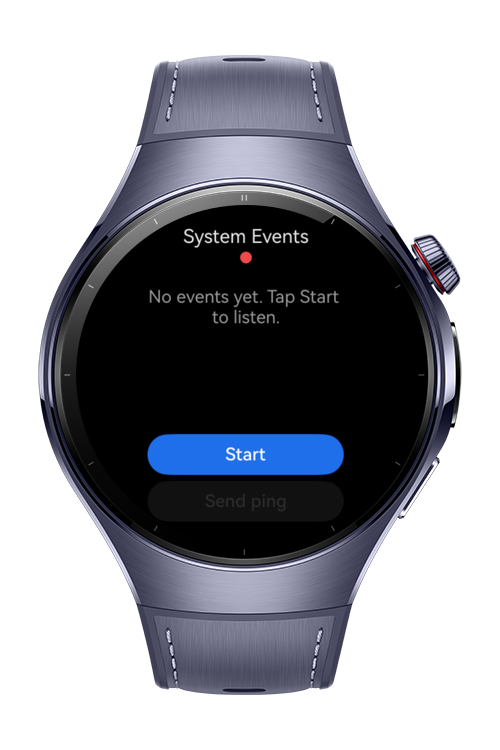
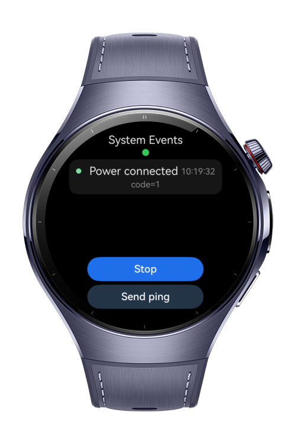
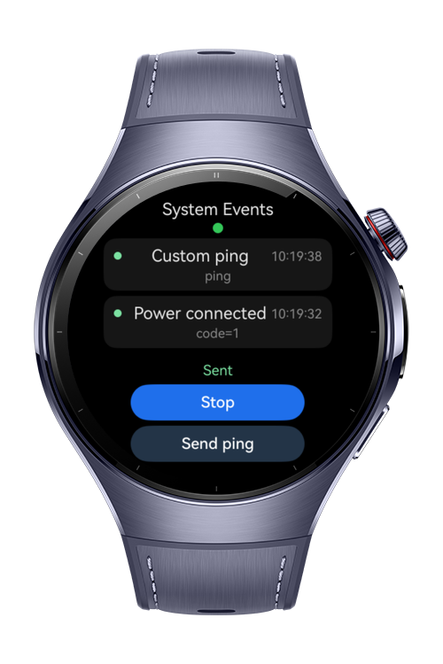

> **Note:** To access all shared projects, get information about environment setup, and view other guides, please visit [Explore-In-HMOS Index](https://github.com/Explore-In-HMOS/hmos-index).

# How To Build System Event Monitor

**How To Build System Event Monitor** is a HarmonyOS wearable codelab for `how-to-build-system-event-monitor` that subscribes to common system events and shows them in a compact live feed on a circular watch display. It is built around `commonEventManager` from BasicServicesKit, subscribes to battery, power, screen, timezone, and connectivity events, and lets the user publish a small custom event to demonstrate event-driven workflows.

# Preview

<div align="center">
  
  
  
</div>

# Use Cases

- Observe system signals on the watch as they happen: battery low / okay, charger connected / disconnected, screen on / off, timezone changes, and best-effort connectivity changes.
- Publish a small custom common event from the watch as a starting point for downstream automation on paired devices or other HarmonyOS components.
- Educational reference for `CommonEventSubscribeInfo`, `CommonEventSubscriber`, and `CommonEventPublishData` on a wearable form factor.

# Tech Stack

- **Languages**: ArkTS / ArkUI
- **Frameworks**: HarmonyOS SDK 6.0.1, BasicServicesKit / `commonEventManager`
- **Tools**: DevEco Studio
- **Navigation**: `Navigation` with `NavPathStack`

# Directory Structure

```
entry/src/main/ets/
├─ entryability/        UIAbility lifecycle, calls service.dispose() on teardown
├─ entrybackupability/  Default backup ability (untouched)
├─ pages/               Index (Navigation host) + MainPage (single screen)
├─ components/          EventCard, StatusChip, PrimaryActionButton, EmptyFeed
├─ model/               EventRecord, MonitorState
├─ services/            CommonEventService wraps commonEventManager
├─ constants/           EventActions, UiConstants
└─ utils/               Formatters (timestamp, label lookup, monotonic id)
```

# Constraints and Restrictions

- The feed is capped at 20 entries to stay readable on a small screen.
- Some system events may not fire on every Watch firmware or on the simulator. The app handles silence gracefully via the empty state, and surfaces subscribe / publish failures inline.
- Charging events (`usual.event.POWER_CONNECTED` / `POWER_DISCONNECTED`) are part of the realistic wearable workflow and are best verified on a Huawei Watch 5 device. The DevEco wearable emulator may not emit them; the reliable simulator verification path is the custom event publish/subscribe loop.
- Monitoring is started and stopped explicitly by the user. The app does not auto-stop on transient page lifecycle events.
- No runtime permissions are declared. Adding events that require permissions would also require adding a Required Permissions section here.

## Supported Devices

- Huawei Watch 5
- DevEco Studio Simulator

# License

**How To Build System Event Monitor** is distributed under the terms of the MIT License.
See the [LICENSE](/LICENSE) for more information.
